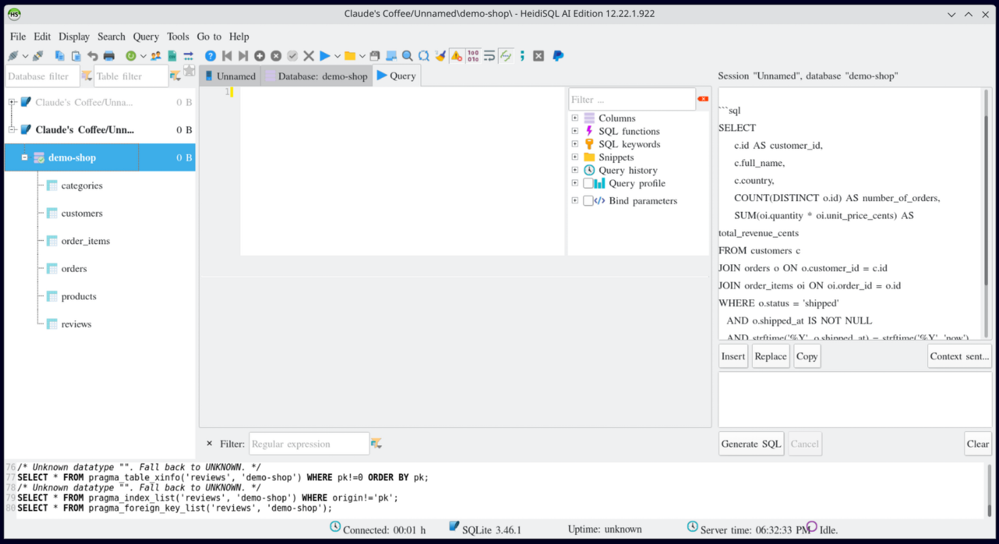

# HeidiSQL AI Edition

A fork of [HeidiSQL](https://www.heidisql.com) with an AI assistant that writes, explains,
optimizes and fixes SQL for the database you are connected to. It uses an AI server you choose:
a local one such as Ollama, so nothing leaves your computer, or any OpenAI-compatible service.

[](https://github.com/ggrace519/HeidiSQL/actions/workflows/lazarus.yaml?query=branch%3Alazarus)
[](https://github.com/ggrace519/HeidiSQL/releases/latest)
[](https://github.com/ggrace519/HeidiSQL/releases/latest)
[](#building)
[](#building)
[](https://github.com/ggrace519/HeidiSQL/blob/lazarus/LICENSE)
[](https://github.com/ggrace519/HeidiSQL/releases)



Everything else is HeidiSQL: a desktop SQL client for MariaDB, MySQL, PostgreSQL, Microsoft SQL
Server, SQLite, Interbase and Firebird. The AI Edition is built from the HeidiSQL
Lazarus/FreePascal port and installs next to a stock HeidiSQL without touching its settings.
As in that port, Windows-only parts such as ADO were left out; Microsoft SQL Server support is
being redeveloped on FreeTDS and is not yet fully mature.

## Features

- **Generate SQL:** describe a query in your own words. The assistant writes SQL for the selected
  database from its tables, columns and keys, and streams the answer into a side panel. Insert,
  Replace or Copy put it into the query editor; nothing is executed.
- **Explain, Optimize and Fix error:** a plain-language explanation of a query, a faster version
  with index suggestions, or corrected SQL after a query fails.
- **Your choice of AI server:** Ollama, LM Studio, vLLM, OpenRouter, OpenAI or any
  OpenAI-compatible server. API keys stay in the system keychain, never in HeidiSQL's settings.
- **Off until you enable it, per session.** Only the schema (names, types, keys, comments,
  approximate row counts), your notes and the SQL in question are sent, never table data.
  **Context sent...** shows exactly what went to the server.
- **Separate settings** (`~/.config/heidisql-ai/`), with an offer on first start to copy sessions
  and preferences from a stock HeidiSQL.

## Install

On Debian, Ubuntu or Fedora (64-bit x86), this installs the latest release's package with apt or
dnf:

```sh
curl -fsSL https://github.com/ggrace519/HeidiSQL/releases/latest/download/install.sh | sh
```

Then start **HeidiSQL AI Edition** from the application menu, or run `heidisql-ai`. To read the
script first, download it from the [releases page](https://github.com/ggrace519/HeidiSQL/releases/latest)
and run `sh install.sh`.

The releases page also has the `.deb` and `.rpm` packages to install yourself, and archives for
GTK2, Qt5, Qt6 and Qt6 on ARM64. Windows and macOS users [build from source](#building) for now.

## Getting started with the assistant

1. **Tools > Preferences > AI providers:** check the "Local Ollama" provider, or add your AI server,
   then press **Test**.
2. In the session manager, open a session's **LLM Settings** tab and tick **Enable AI assistant
   for this session**. Notes about the database (units, status codes, conventions) help the model.
3. Connect, select a database and press **Ctrl+Shift+G** to describe the query you want.

[AI-EDITION.md](AI-EDITION.md) is the full guide: providers and API keys, what is sent, every
assistant command, and all differences from stock HeidiSQL.

## Building

Install Lazarus 4.8 and FreePascal 3.2.2 (the versions used by the CI build), then:

```sh
make build-gtk2      # or build-qt5, build-qt6; output in out/<variant>/heidisql
make test            # unit tests
make packages-ai     # .deb and .rpm from the GTK2 build, needs nfpm
```

Or load `heidisql.lpi` in the Lazarus IDE, or run `lazbuild heidisql.lpi`.

### Patching Lazarus 4.8
Local fixes for Lazarus 4.8 live in `extra/lazarus-patches/4.8/`. The CI applies all of them to the
Lazarus installation before building, and local builds should do the same:

```bash
for p in extra/lazarus-patches/4.8/*.patch; do
  patch -d /path/to/lazarus -p1 --dry-run < "$p" && patch -d /path/to/lazarus -p1 < "$p"
done
```
On Windows, use `patch --binary -p1` instead: without `--binary`, GNU patch strips the CRs from
the patch and rewrites the entire target file with LF line endings.

Patches are stored with LF line endings in the repository, so they match the LF line endings of
the Linux Lazarus installation applied by the CI. With `core.autocrlf=true` the Windows checkout
has CRLF line endings, matching the CRLF Lazarus installation for local application.

Generate new patches as commits in a git baseline of the local Lazarus installation and export them
with `git diff`, then convert to CRLF with `unix2dos` before applying locally with `patch --binary`.

The Cocoa patches fix undersized fonts and icons in all VirtualTree controls on retina displays,
caused by the blit scaling changes in Lazarus 4.6+ (upstream issues #41313/#41299).

## Contributing

Pull requests go to the `develop` branch; `lazarus` holds what is released, and releases are
made by the CI ([DECISIONS.md](DECISIONS.md), ADR-011). Changes are listed in
[CHANGELOG-AI.md](CHANGELOG-AI.md). Bugs in HeidiSQL itself, unrelated to the AI Edition, belong
to the [upstream project](https://github.com/HeidiSQL/HeidiSQL/issues).

## Credits and license

HeidiSQL is created and maintained by Ansgar Becker and contributors at
[heidisql.com](https://www.heidisql.com) and [HeidiSQL/HeidiSQL](https://github.com/HeidiSQL/HeidiSQL).
The Lazarus/FreePascal port this fork builds on is his migration of HeidiSQL to Linux and macOS,
started in February 2025. The AI Edition is an independent fork and is not affiliated with or
endorsed by the HeidiSQL project. Licensed under the [GNU GPL v2](LICENSE), like HeidiSQL.

### Icons8 copyright
Icons added in January 2019 are copyright by [Icons8](https://icons8.com). Used with a special permission
from Icons8 given to Ansgar for this project only. Do not copy them for anything else other than building
HeidiSQL.

[](https://www.lazarus-ide.org/)
